# 🗄️ TÀI LIỆU CƠ SỞ DỮ LIỆU - CODELEARN C++ ACADEMY

Tài liệu thiết kế kiến trúc, lược đồ thực thể quan hệ (ERD), từ điển dữ liệu chi tiết và hướng dẫn vận hành cơ sở dữ liệu cho nền tảng **CodeLearn C++**.

---

## 1. Tổng Quan Kiến Trúc Database

- **Hệ quản trị mặc định:** SQLite 3 (Lưu trữ tập trung tại `backend/database.db`).
- **Khả năng tương thích:** Chuẩn ANSI SQL, sẵn sàng chuyển đổi (migration) sang **MySQL 8.0+** hoặc **PostgreSQL 14+** qua tệp `backend/schema.sql` và `backend/seed.sql`.
- **Cơ chế lưu trữ:**
  - **Server Mode:** Lưu trữ 15 bảng quan hệ chuẩn 3NF trong SQLite với chế độ WAL (Write-Ahead Logging), đảm bảo ACID, hỗ trợ Foreign Keys Cascade (`PRAGMA foreign_keys = ON`).
  - **Client Mode (Offline-First):** Tự động đồng bộ trạng thái sang `localStorage` để học viên vẫn học tập và làm bài mượt mà ngay cả khi mất mạng.

---

## 2. Sơ Đồ Thực Thể Liên Kết (Entity-Relationship Diagram - 15 Bảng)

```mermaid
erDiagram
    USERS ||--o{ SESSIONS : "tạo phiên"
    USERS ||--o{ PROGRESS : "lưu tiến độ"
    USERS ||--o{ SUBMISSIONS : "nộp bài code"
    USERS ||--o{ CERTIFICATES : "nhận chứng chỉ"
    USERS ||--o{ USER_ACHIEVEMENTS : "mở khóa danh hiệu"
    USERS ||--o{ COMMENTS : "thảo luận bài học"
    USERS ||--o{ ACTIVITY_LOGS : "ghi nhật ký"
    USERS ||--o{ AI_CHAT_MESSAGES : "trò chuyện AI"
    
    LESSONS ||--|{ EXERCISES : "chứa 3 bài tập"
    LESSONS ||--o{ PROGRESS : "được học"
    LESSONS ||--o{ SUBMISSIONS : "được thực hành"
    LESSONS ||--o{ COMMENTS : "có bình luận"
    
    EXERCISES ||--o{ SUBMISSIONS : "được chấm điểm"
    EXERCISES ||--|{ TEST_CASES : "có testcases"
    
    ACHIEVEMENTS ||--o{ USER_ACHIEVEMENTS : "thuộc danh mục"

    USERS {
        string id PK "user-xxx"
        string username UK "Tên đăng nhập"
        string email UK "Email học viên"
        string password_hash "Mã băm SHA-256 có Salt"
        string full_name "Họ và tên hiển thị"
        string role "student | admin"
        string avatar "Avatar URL hoặc Preset ID"
        datetime created_at
        datetime updated_at
    }

    SESSIONS {
        string token PK "UUID v4 Token"
        string user_id FK "Liên kết USERS.id"
        datetime created_at
        datetime expires_at "Hết hạn sau 30 ngày"
    }

    LESSONS {
        string id PK "lesson-01, lesson-02..."
        string title "Tiêu đề bài học"
        string chapter "Tên chương học"
        string description "Mô tả ngắn"
        string level "Cơ bản | Trung bình | Nâng cao"
        string duration "Thời lượng học ước tính"
        text content "Nội dung lý thuyết (HTML/Markdown)"
        text example "Mã nguồn ví dụ minh họa"
        string exercise_title "Tiêu đề bài tập"
        string exercise_description "Mô tả yêu cầu thực hành"
        text starter_code "Khung code khởi tạo sẵn"
        int order_num "Thứ tự sắp xếp (1 - 20)"
        datetime created_at
    }

    EXERCISES {
        string id PK "ex-1, ex-2, ex-3"
        string lesson_id PK,FK "Liên kết LESSONS.id"
        string title "Tiêu đề bài tập"
        string level "Cơ bản | Vận dụng | Thử thách"
        string difficulty "easy | medium | hard"
        int points "Điểm số tối đa (100)"
        string description "Đề bài chi tiết"
        text starter_code "Mã C++ mẫu ban đầu"
        text expected_output "Đầu ra mong đợi để AI chấm"
        string hint "Gợi ý giải bài"
        text test_keywords "Từ khóa C++ bắt buộc (JSON)"
        int order_num "Thứ tự bài tập (1, 2, 3)"
    }

    TEST_CASES {
        string id PK "tc-lesson-01-ex-1-1"
        string lesson_id FK "Liên kết EXERCISES.lesson_id"
        string exercise_id FK "Liên kết EXERCISES.id"
        text input_data "Dữ liệu stdin (cin)"
        text expected_output "Dữ liệu stdout mong đợi"
        int is_hidden "0 = Công khai, 1 = Ẩn"
        int weight_points "Trọng số điểm (50)"
        int order_num "Thứ tự test case"
    }

    PROGRESS {
        string id PK "prog-xxx"
        string user_id FK "Liên kết USERS.id"
        string lesson_id FK "Liên kết LESSONS.id"
        string status "not_started | in_progress | completed"
        text code "Code bài làm gần nhất"
        int score "Điểm số đạt được (0 - 100)"
        string comprehension_level "Mức độ hiểu bài do AI đánh giá"
        datetime completed_at
        datetime updated_at
    }

    SUBMISSIONS {
        string id PK "sub-xxx"
        string user_id FK "Liên kết USERS.id"
        string lesson_id FK "Liên kết LESSONS.id"
        string exercise_id FK "Mã bài tập"
        text code "Mã nguồn nộp bài"
        text output "Kết quả thực thi từ G++"
        int passed "1 = Đạt, 0 = Chưa đạt"
        int score "Điểm chấm AI (0 - 100)"
        real execution_time_ms "Thời gian chạy máy (ms)"
        text ai_feedback "Nhận xét chi tiết của AI"
        datetime submitted_at
    }

    SETTINGS {
        string key PK "Tên tham số cấu hình"
        text value "Giá trị cấu hình"
    }

    CERTIFICATES {
        string id PK "Mã chứng chỉ UUID"
        string cert_code UK "CERT-CPP-2026-XXXX"
        string user_id FK "Liên kết USERS.id"
        string course_name "Tên khóa học tốt nghiệp"
        int final_score "Điểm tổng kết khóa"
        datetime issued_at "Thời gian cấp"
        string verification_hash "Mã băm SHA-256 xác thực"
    }

    ACHIEVEMENTS {
        string id PK "ach-1, ach-2..."
        string code UK "Mã định danh thành tựu"
        string title "Tên huy hiệu"
        string description "Mô tả điều kiện đạt"
        int points "Điểm thưởng"
        int order_num "Thứ tự hiển thị"
    }

    USER_ACHIEVEMENTS {
        string user_id PK,FK "Liên kết USERS.id"
        string achievement_id PK,FK "Liên kết ACHIEVEMENTS.id"
        datetime unlocked_at "Thời điểm mở khóa"
    }

    COMMENTS {
        string id PK "cm-xxx"
        string lesson_id FK "Liên kết LESSONS.id"
        string user_id FK "Liên kết USERS.id"
        string parent_id "Liên kết phản hồi (NULL nếu cấp 1)"
        text content "Nội dung thảo luận"
        datetime created_at
    }

    ACTIVITY_LOGS {
        string id PK "log-xxx"
        string user_id "Mã người dùng (hoặc Guest)"
        string action "Hành vi (login, compile, claim_cert...)"
        string ip_address "Địa chỉ IP thực hiện"
        text details "Chi tiết nhật ký"
        datetime created_at
    }

    AI_CHAT_MESSAGES {
        string id PK "msg-xxx"
        string user_id FK "Liên kết USERS.id"
        string role "user | assistant"
        text content "Nội dung tin nhắn"
        string persona "tutor | interviewer | professor"
        text code_snippet "Đoạn code minh họa"
        string lesson_id "Chuyên đề tham chiếu"
        datetime created_at
    }

    VNOI_REAL_KNOWLEDGE {
        string id PK "vnoi-xxx"
        string title "Tiêu đề bài viết học thuật"
        string category "languages | basic | dp | graph"
        string author "Tác giả uy tín VNOI"
        string source_url "Liên kết bài viết gốc"
        text keywords "Mảng từ khóa tìm kiếm (JSON)"
        text summary "Tóm tắt cốt lõi"
        text content "Nội dung bài viết đầy đủ"
        text code_sample "Mã nguồn C++ tối ưu"
        datetime updated_at
    }
```



---

## 3. Từ Điển Dữ Liệu Chi Tiết (Data Dictionary - Toàn Bộ 15 Bảng)

### 3.1. Bảng `users` (Người dùng & Học viên)
| Tên cột | Kiểu dữ liệu | Ràng buộc | Mô tả |
| :--- | :--- | :--- | :--- |
| `id` | `TEXT` | `PRIMARY KEY` | Định danh duy nhất (VD: `user-admin`, `user-student`) |
| `username` | `TEXT` | `UNIQUE NOT NULL` | Tên tài khoản đăng nhập (chữ, số, `_`, `.`) |
| `email` | `TEXT` | `UNIQUE NOT NULL` | Email liên hệ của học viên |
| `password_hash` | `TEXT` | `NOT NULL` | Mật khẩu băm an toàn SHA-256 kèm chuỗi Salt bí mật |
| `full_name` | `TEXT` | `NOT NULL` | Tên họ đầy đủ của học viên / Quản trị viên |
| `role` | `TEXT` | `DEFAULT 'student'` | Quyền hạn: `student` (học viên) hoặc `admin` (quản trị) |
| `avatar` | `TEXT` | `DEFAULT ''` | Tên mẫu preset (VD: `preset-coder-boy`) hoặc Base64 ảnh |
| `created_at` | `TEXT` | `NOT NULL` | Thời gian tạo tài khoản (ISO 8601) |
| `updated_at` | `TEXT` | `NOT NULL` | Thời gian cập nhật gần nhất |

### 3.2. Bảng `sessions` (Phiên làm việc & Token xác thực)
| Tên cột | Kiểu dữ liệu | Ràng buộc | Mô tả |
| :--- | :--- | :--- | :--- |
| `token` | `TEXT` | `PRIMARY KEY` | Chuỗi token bảo mật UUID v4 |
| `user_id` | `TEXT` | `NOT NULL, FK` | Khóa ngoại liên kết `users.id` (ON DELETE CASCADE) |
| `created_at` | `TEXT` | `NOT NULL` | Thời gian khởi tạo phiên |
| `expires_at` | `TEXT` | `NOT NULL` | Thời điểm hết hạn phiên (mặc định 30 ngày) |

### 3.3. Bảng `lessons` (20 Chuyên đề C++ Toàn diện)
| Tên cột | Kiểu dữ liệu | Ràng buộc | Mô tả |
| :--- | :--- | :--- | :--- |
| `id` | `TEXT` | `PRIMARY KEY` | Mã bài học (`lesson-01`, `lesson-02`,..., `lesson-20`) |
| `title` | `TEXT` | `NOT NULL` | Tiêu đề bài học |
| `chapter` | `TEXT` | `NOT NULL` | Tên chương (Chương 1 đến Chương 7) |
| `description` | `TEXT` | `NOT NULL` | Mô tả tóm tắt nội dung |
| `level` | `TEXT` | `NOT NULL` | Mức độ: Cơ bản / Trung bình / Nâng cao |
| `duration` | `TEXT` | `NOT NULL` | Thời gian học ước lượng (VD: `20 phút`, `35 phút`) |
| `content` | `TEXT` | `NOT NULL` | Nội dung lý thuyết định dạng HTML chuẩn SEO & Hộp ứng dụng thực tế |
| `example` | `TEXT` | `NOT NULL` | Mã C++ mẫu hoàn chỉnh có chú thích |
| `exercise_title`| `TEXT` | `NOT NULL` | Tiêu đề tóm tắt bài tập thực hành |
| `exercise_description` | `TEXT` | `NOT NULL` | Đề bài yêu cầu |
| `starter_code` | `TEXT` | `NOT NULL` | Khung mã C++ sẵn sàng trong code editor |
| `order_num` | `INTEGER`| `NOT NULL` | Thứ tự hiển thị tăng dần (1 đến 20) |
| `created_at` | `TEXT` | `NOT NULL` | Ngày tạo bài học |

### 3.4. Bảng `exercises` (60 Bài tập thực hành 3 cấp độ)
Mỗi bài học gồm **3 bài tập phân cấp chuẩn mực**:
1. `ex-1`: Cấp độ **Cơ bản** (`easy`, 100 điểm) - Khắc sâu cú pháp cơ bản.
2. `ex-2`: Cấp độ **Vận dụng** (`medium`, 100 điểm) - Xây dựng tư duy giải quyết vấn đề.
3. `ex-3`: Cấp độ **Thử thách** (`hard`, 100 điểm) - Nâng cao thuật toán & tối ưu mã nguồn.

| Tên cột | Kiểu dữ liệu | Ràng buộc | Mô tả |
| :--- | :--- | :--- | :--- |
| `id` | `TEXT` | `NOT NULL` | Mã bài tập (`ex-1`, `ex-2`, `ex-3`) |
| `lesson_id` | `TEXT` | `NOT NULL, FK` | Khóa ngoại trỏ đến `lessons.id` (ON DELETE CASCADE) |
| `title` | `TEXT` | `NOT NULL` | Tiêu đề cụ thể của bài tập |
| `level` | `TEXT` | `NOT NULL` | Cơ bản / Vận dụng / Thử thách |
| `difficulty` | `TEXT` | `NOT NULL` | `easy` / `medium` / `hard` |
| `points` | `INTEGER`| `DEFAULT 100` | Điểm số bài tập |
| `description` | `TEXT` | `NOT NULL` | Yêu cầu bài tập chi tiết |
| `starter_code`| `TEXT` | `NOT NULL` | Code ban đầu trong cửa sổ Editor |
| `expected_output` | `TEXT`| `DEFAULT ''` | Kết quả in ra mong đợi (để đối chiếu) |
| `hint` | `TEXT` | `DEFAULT ''` | Gợi ý thuật toán hoặc hàm cần dùng |
| `test_keywords`| `TEXT` | `DEFAULT '[]'` | Mảng JSON các từ khóa cú pháp C++ bắt buộc |
| `order_num` | `INTEGER`| `NOT NULL` | Thứ tự 1, 2 hoặc 3 trong bài học |

### 3.5. Bảng `test_cases` (Bộ kiểm thử đa trường hợp cho 60 bài tập)
| Tên cột | Kiểu dữ liệu | Ràng buộc | Mô tả |
| :--- | :--- | :--- | :--- |
| `id` | `TEXT` | `PRIMARY KEY` | Mã test case (VD: `tc-lesson-01-ex-1-1`) |
| `lesson_id` | `TEXT` | `NOT NULL, FK` | Khóa ngoại trỏ đến `lessons.id` |
| `exercise_id` | `TEXT` | `NOT NULL, FK` | Khóa ngoại trỏ đến `exercises.id` |
| `input_data` | `TEXT` | `DEFAULT ''` | Dữ liệu đầu vào chuẩn stdin (`cin`) |
| `expected_output` | `TEXT` | `NOT NULL` | Dữ liệu đầu ra stdout mong đợi |
| `is_hidden` | `INTEGER` | `DEFAULT 0` | `0` = Test case công khai, `1` = Test case ẩn chống gian lận |
| `weight_points` | `INTEGER` | `DEFAULT 50` | Trọng số điểm kiểm thử của ca này |
| `order_num` | `INTEGER` | `DEFAULT 1` | Thứ tự ca kiểm thử trong bài tập |

### 3.6. Bảng `progress` (Tiến độ học tập của học viên)
| Tên cột | Kiểu dữ liệu | Ràng buộc | Mô tả |
| :--- | :--- | :--- | :--- |
| `id` | `TEXT` | `PRIMARY KEY` | Mã tiến độ (`prog-xxx`) |
| `user_id` | `TEXT` | `NOT NULL, FK` | Khóa ngoại trỏ đến `users.id` (ON DELETE CASCADE) |
| `lesson_id` | `TEXT` | `NOT NULL, FK` | Khóa ngoại trỏ đến `lessons.id` (ON DELETE CASCADE) |
| `status` | `TEXT` | `DEFAULT 'not_started'` | Trạng thái: `not_started`, `in_progress`, `completed` |
| `code` | `TEXT` | `DEFAULT ''` | Mã nguồn bài làm gần nhất của học viên |
| `score` | `INTEGER` | `DEFAULT 0` | Điểm bài tập học viên đạt được (0 đến 100) |
| `comprehension_level` | `TEXT` | `DEFAULT ''` | Đánh giá năng lực của AI Mentor |
| `completed_at` | `TEXT` | `NULL` | Thời điểm hoàn thành bài học |
| `updated_at` | `TEXT` | `NOT NULL` | Thời gian cập nhật gần nhất |

### 3.7. Bảng `submissions` (Lịch sử nộp bài & Đánh giá AI)
| Tên cột | Kiểu dữ liệu | Ràng buộc | Mô tả |
| :--- | :--- | :--- | :--- |
| `id` | `TEXT` | `PRIMARY KEY` | Mã bài nộp (`sub-xxx`) |
| `user_id` | `TEXT` | `NOT NULL, FK` | Khóa ngoại trỏ đến `users.id` |
| `lesson_id` | `TEXT` | `NOT NULL` | Mã bài học thực hành |
| `exercise_id` | `TEXT` | `NOT NULL` | Mã bài tập thực hành |
| `code` | `TEXT` | `NOT NULL` | Mã nguồn C++ học viên gửi lên |
| `output` | `TEXT` | `DEFAULT ''` | Kết quả in ra từ trình biên dịch MSYS2 `g++ 13.2.0` |
| `passed` | `INTEGER` | `DEFAULT 0` | `1` = Đạt bài tập, `0` = Chưa đạt |
| `score` | `INTEGER` | `DEFAULT 0` | Thang điểm AI chấm (0 đến 100) |
| `execution_time_ms` | `REAL` | `DEFAULT 0` | Thời gian chạy máy thực tế (ms) |
| `ai_feedback` | `TEXT` | `DEFAULT ''` | Nhận xét phân tích điểm mạnh và điểm cần cải thiện |
| `submitted_at` | `TEXT` | `NOT NULL` | Thời điểm nộp bài |

### 3.8. Bảng `settings` (Cấu hình hệ thống & Khóa học)
| Tên cột | Kiểu dữ liệu | Ràng buộc | Mô tả |
| :--- | :--- | :--- | :--- |
| `key` | `TEXT` | `PRIMARY KEY` | Khóa cấu hình (VD: `site_name`, `compiler_default`, `max_execution_time_ms`) |
| `value` | `TEXT` | `NOT NULL` | Giá trị tham số tương ứng |

### 3.9. Bảng `certificates` (Chứng chỉ tốt nghiệp xác thực điện tử)
| Tên cột | Kiểu dữ liệu | Ràng buộc | Mô tả |
| :--- | :--- | :--- | :--- |
| `id` | `TEXT` | `PRIMARY KEY` | Định danh UUID chứng chỉ |
| `cert_code` | `TEXT` | `UNIQUE NOT NULL` | Mã tra cứu công khai (VD: `CERT-CPP-2026-XXXX`) |
| `user_id` | `TEXT` | `NOT NULL, FK` | Khóa ngoại trỏ đến `users.id` (ON DELETE CASCADE) |
| `course_name` | `TEXT` | `NOT NULL` | Tên khóa học tốt nghiệp |
| `final_score` | `INTEGER` | `NOT NULL` | Điểm tổng kết toàn khóa học |
| `issued_at` | `TEXT` | `NOT NULL` | Thời điểm cấp chứng chỉ |
| `verification_hash` | `TEXT` | `NOT NULL` | Mã băm SHA-256 bảo mật chống làm giả chứng chỉ |

### 3.10. Bảng `achievements` (Danh mục danh hiệu & huy hiệu)
| Tên cột | Kiểu dữ liệu | Ràng buộc | Mô tả |
| :--- | :--- | :--- | :--- |
| `id` | `TEXT` | `PRIMARY KEY` | Mã danh hiệu (`ach-1`, `ach-2`...) |
| `code` | `TEXT` | `UNIQUE NOT NULL` | Mã code (`first_lesson`, `master`...) |
| `title` | `TEXT` | `NOT NULL` | Tên huy hiệu hiển thị |
| `description` | `TEXT` | `NOT NULL` | Điều kiện mở khóa huy hiệu |
| `points` | `INTEGER` | `DEFAULT 50` | Điểm kinh nghiệm tích lũy khi mở khóa |
| `order_num` | `INTEGER` | `DEFAULT 1` | Thứ tự hiển thị trong hồ sơ cá nhân |

### 3.11. Bảng `user_achievements` (Thành tựu đã mở khóa của học viên)
| Tên cột | Kiểu dữ liệu | Ràng buộc | Mô tả |
| :--- | :--- | :--- | :--- |
| `user_id` | `TEXT` | `NOT NULL, FK` | Khóa ngoại liên kết `users.id` (ON DELETE CASCADE) |
| `achievement_id` | `TEXT` | `NOT NULL, FK` | Khóa ngoại liên kết `achievements.id` (ON DELETE CASCADE) |
| `unlocked_at` | `TEXT` | `NOT NULL` | Thời điểm học viên chinh phục thành công |

### 3.12. Bảng `comments` (Hỏi đáp & Thảo luận bài học)
| Tên cột | Kiểu dữ liệu | Ràng buộc | Mô tả |
| :--- | :--- | :--- | :--- |
| `id` | `TEXT` | `PRIMARY KEY` | Mã bình luận (`cm-xxx`) |
| `lesson_id` | `TEXT` | `NOT NULL, FK` | Khóa ngoại trỏ đến `lessons.id` (ON DELETE CASCADE) |
| `user_id` | `TEXT` | `NOT NULL, FK` | Khóa ngoại trỏ đến `users.id` (ON DELETE CASCADE) |
| `parent_id` | `TEXT` | `NULL` | Khóa tự tham chiếu trả lời bình luận cấp cha |
| `content` | `TEXT` | `NOT NULL` | Nội dung câu hỏi / giải đáp thảo luận |
| `created_at` | `TEXT` | `NOT NULL` | Thời điểm gửi bình luận |

### 3.13. Bảng `activity_logs` (Nhật ký kiểm toán an toàn hệ thống)
| Tên cột | Kiểu dữ liệu | Ràng buộc | Mô tả |
| :--- | :--- | :--- | :--- |
| `id` | `TEXT` | `PRIMARY KEY` | Mã bản ghi nhật ký |
| `user_id` | `TEXT` | `NULL` | ID người dùng thực hiện (hoặc Guest) |
| `action` | `TEXT` | `NOT NULL` | Hành động (`login`, `compile`, `claim_cert`, `update_profile`...) |
| `ip_address` | `TEXT` | `DEFAULT ''` | Địa chỉ IP của máy khách |
| `details` | `TEXT` | `DEFAULT ''` | Chi tiết thao tác và phản hồi hệ thống |
| `created_at` | `TEXT` | `NOT NULL` | Thời điểm ghi nhận thao tác |

### 3.14. Bảng `ai_chat_messages` (Lịch sử hội thoại với Trợ lý AI Mentor)
| Tên cột | Kiểu dữ liệu | Ràng buộc | Mô tả |
| :--- | :--- | :--- | :--- |
| `id` | `TEXT` | `PRIMARY KEY` | Mã tin nhắn (`msg-xxx`) |
| `user_id` | `TEXT` | `NOT NULL, FK` | Khóa ngoại liên kết `users.id` (ON DELETE CASCADE) |
| `role` | `TEXT` | `NOT NULL` | Vai trò: `user` (người hỏi) hoặc `assistant` (AI trợ giảng) |
| `content` | `TEXT` | `NOT NULL` | Nội dung trao đổi, phân tích và hướng dẫn |
| `persona` | `TEXT` | `DEFAULT 'tutor'` | Phong cách AI: `tutor` (gia sư), `interviewer` (phỏng vấn), `professor` (giáo sư) |
| `code_snippet` | `TEXT` | `DEFAULT ''` | Đoạn mã C++ minh họa kèm theo |
| `lesson_id` | `TEXT` | `DEFAULT ''` | Chuyên đề bài học học viên đang thao tác |
| `created_at` | `TEXT` | `NOT NULL` | Thời điểm gửi tin nhắn |

### 3.15. Bảng `vnoi_real_knowledge` (Kho tri thức thật từ VNOI Wiki)
| Tên cột | Kiểu dữ liệu | Ràng buộc | Mô tả |
| :--- | :--- | :--- | :--- |
| `id` | `TEXT` | `PRIMARY KEY` | Mã bài viết VNOI (`vnoi-xxx`) |
| `title` | `TEXT` | `NOT NULL` | Tiêu đề bài viết học thuật uy tín |
| `category` | `TEXT` | `NOT NULL` | Chuyên mục: `languages`, `basic`, `data-structures`, `dp`, `graph`, `interview` |
| `author` | `TEXT` | `DEFAULT ''` | Tác giả bài viết uy tín (VD: Phạm Văn Hạnh - IOI Gold Medalist) |
| `source_url` | `TEXT` | `DEFAULT ''` | Liên kết bài viết gốc trên VNOI Wiki |
| `keywords` | `TEXT` | `NOT NULL` | Mảng JSON các từ khóa tra cứu liên quan |
| `summary` | `TEXT` | `NOT NULL` | Tóm tắt cô đọng nguyên lý thuật toán |
| `content` | `TEXT` | `NOT NULL` | Nội dung bài giảng chuyên sâu định dạng Markdown |
| `code_sample` | `TEXT` | `DEFAULT ''` | Mã nguồn C++ chuẩn mực minh họa |
| `updated_at` | `TEXT` | `NOT NULL` | Thời điểm cập nhật dữ liệu |

---

## 4. Các Tệp Dữ Liệu Cung Cấp Sẵn Trong Thư Mục `backend/`

| Tệp tin | Định dạng | Mục đích sử dụng |
| :--- | :---: | :--- |
| [`backend/database.db`](file:///d:/Wed/cpp-basic-academy/backend/database.db) | SQLite Binary | Tệp cơ sở dữ liệu vật lý đang hoạt động trực tiếp của hệ thống (15 bảng, WAL mode). |
| [`backend/schema.sql`](file:///d:/Wed/cpp-basic-academy/backend/schema.sql) | ANSI SQL DDL | Kịch bản tạo toàn bộ 15 bảng dữ liệu, chỉ mục (Index) và ràng buộc khóa ngoại. |
| [`backend/seed.sql`](file:///d:/Wed/cpp-basic-academy/backend/seed.sql) | SQL INSERT | Dữ liệu mẫu hoàn chỉnh 15 bảng: 20 bài học, 60 bài tập, 120 test cases, 11 cài đặt, 19 bài VNOI... |
| [`backend/database_dump.json`](file:///d:/Wed/cpp-basic-academy/backend/database_dump.json) | JSON Format | Toàn bộ dữ liệu trích xuất dạng JSON tiêu chuẩn cho REST API / Frontend / NoSQL. |
| [`backend/database_manager.py`](file:///d:/Wed/cpp-basic-academy/backend/database_manager.py) | Python CLI | Công cụ dòng lệnh hỗ trợ sao lưu, phục hồi, kiểm tra toàn vẹn và xuất dữ liệu cả 15 bảng. |
| `backend/backups/` | Thư mục | Nơi lưu trữ các bản sao lưu database tự động (`backup_YYYYMMDD_HHMMSS.db`). |

---

## 5. Hướng Dẫn Vận Hành & Quản Lý Cơ Sở Dữ Liệu

### 5.1. Xem Thống Kê & Trạng Thái Database (CLI)
```powershell
python backend/database_manager.py stats
```
*Kết quả hiển thị đầy đủ 15 bảng dữ liệu:*
```text
============================================================
📊 THỐNG KÊ CƠ SỞ DỮ LIỆU CODELEARN C++ (DATABASE DASHBOARD)
============================================================
• Đường dẫn file : D:\Wed\cpp-basic-academy\backend\database.db
• Kích thước     : 968.0 KB
• Trạng thái     : HEALTHY (Integrity: ok)
• Bản sao lưu    : 2 bản lưu trong backend/backups/
------------------------------------------------------------
Chi tiết các bảng dữ liệu:
  - [USERS       ]:    3 bản ghi
  - [SESSIONS    ]:   22 bản ghi
  - [LESSONS     ]:   20 bản ghi
  - [EXERCISES   ]:   60 bản ghi
  - [PROGRESS    ]:    1 bản ghi
  - [SUBMISSIONS ]:   12 bản ghi
  - [SETTINGS    ]:   11 bản ghi
  - [CERTIFICATES]:    2 bản ghi
  - [TEST_CASES  ]:  120 bản ghi
  - [ACHIEVEMENTS]:    6 bản ghi
  - [USER_ACHIEVEMENTS]:    4 bản ghi
  - [COMMENTS    ]:   10 bản ghi
  - [ACTIVITY_LOGS]:   15 bản ghi
  - [AI_CHAT_MESSAGES]:    4 bản ghi
  - [VNOI_REAL_KNOWLEDGE]:   19 bản ghi
============================================================
```

### 5.2. Tạo Bản Sao Lưu Database (Backup)
```powershell
python backend/database_manager.py backup
```
*Hệ thống sẽ tạo tệp an toàn dạng `backend/backups/backup_YYYYMMDD_HHMMSS.db`.*

### 5.3. Phục Hồi Database Từ Bản Sao Lưu (Restore)
```powershell
python backend/database_manager.py restore backup_20261013_230000.db
```

### 5.4. Xuất Lại Tệp SQL & JSON Mới Nhất (Export)
```powershell
python backend/database_manager.py export
```

### 5.5. Kiểm Tra Tính Toàn Vẹn Khóa Ngoại (Integrity Check)
```powershell
python backend/database_manager.py check
```

---

## 6. Hướng Dẫn Chuyển Đổi Sang MySQL Hoặc PostgreSQL (Production Migration)

Khi triển khai lên máy chủ Cloud phục vụ hàng ngàn học viên đồng thời:
1. Tạo database mới trên MySQL hoặc PostgreSQL:
   ```sql
   CREATE DATABASE codelearn_cpp CHARACTER SET utf8mb4 COLLATE utf8mb4_unicode_ci;
   ```
2. Thực thi tệp lược đồ hoàn chỉnh:
   ```bash
   mysql -u root -p codelearn_cpp < backend/schema.sql
   ```
3. Nạp dữ liệu mẫu 15 bảng:
   ```bash
   mysql -u root -p codelearn_cpp < backend/seed.sql
   ```
4. Đổi chuỗi kết nối trong `backend/database.py` sang Driver tương ứng (như `pymysql` hoặc `psycopg2`).
